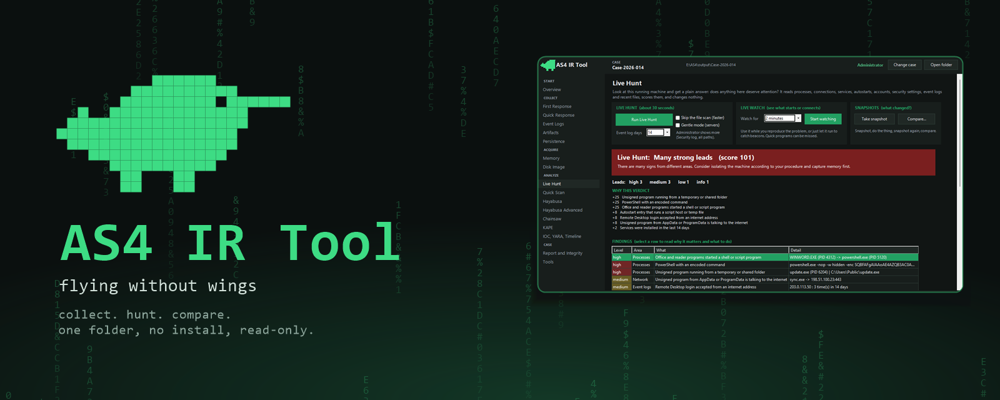
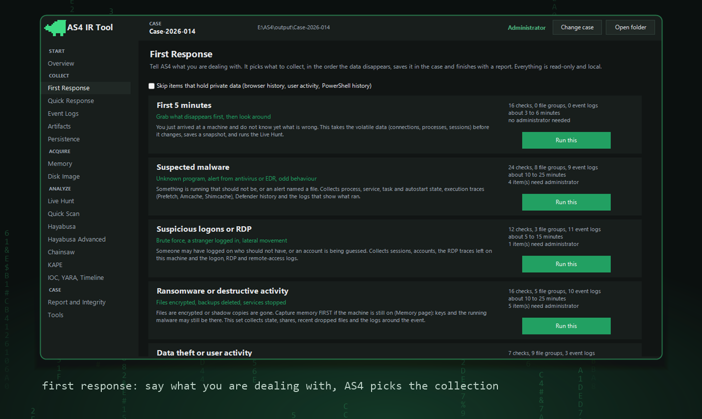
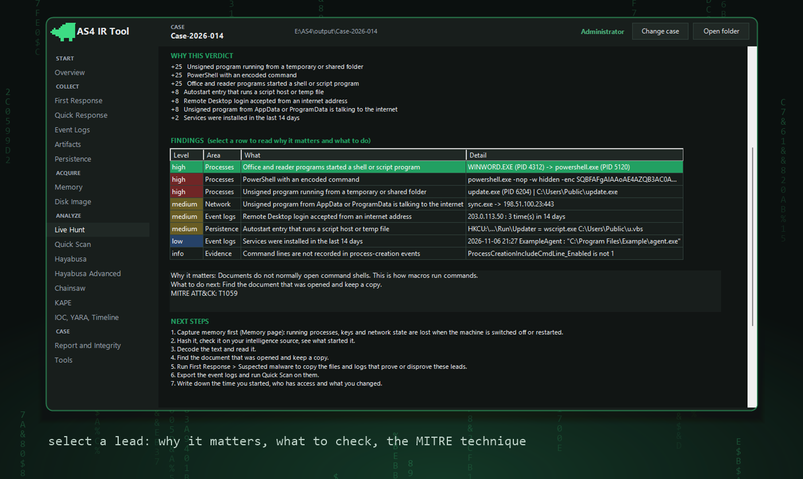

<p align="center"></p>

A Windows machine is acting strange. You have ten minutes before someone reboots it, and you can't install anything on it.

AS4 is one folder for that moment. Copy it to a USB stick, plug it in, double-click. It grabs the evidence that disappears first, looks around, and tells you in plain words if something is wrong.

It only looks. It never kills a process, deletes a file, clears a log, changes a setting or uses the network.

## Get it

1. Open the [latest release](https://github.com/Asf0uRr/AS4-IR-Tool/releases/latest) and download `AS4_IR_Tool_x.x.x.zip`.
2. Right-click the zip, choose Properties, tick **Unblock**, press OK. (Windows blocks downloaded files, this lifts it.)
3. Unzip it anywhere. A USB stick is best.
4. Run `AS4_IR_Tool_Admin.exe`. It asks for administrator, which lets it see much more.
5. Type a case name. Everything it collects goes into `output\<that name>`.

That's it. No installer.

Want to check the download is intact? Run `Get-FileHash .\AS4_IR_Tool_x.x.x.zip` in PowerShell and compare it with `SHA256SUMS.txt` from the release.

## Using it

Click **First Response** and say what you're dealing with:

<p align="center"></p>

AS4 collects the things that vanish first (connections, processes), then files, then logs. Then it runs the Live Hunt and gives you this:

<p align="center"></p>

A verdict, the reasons, and a list of leads. Click a lead to see what it is and what to do about it:

<p align="center"></p>

The report also lists what AS4 could not see, like logs that are switched off or things you can only catch in memory. A tool that always says "all clear" is no use to you.

*(Screenshots show made-up names and sample findings.)*

## What the Live Hunt checks

It takes about half a minute and only reads.

- Windows programs in the wrong place, like a `svchost.exe` outside System32, or a name that's one letter off.
- Word, Excel or a web server starting PowerShell.
- Hidden or encoded commands, LSASS dumps, deleted backups, cleared logs.
- Unsigned programs running from Temp, Downloads or Public.
- Programs that should never touch the internet, but do.
- About twenty spots where malware hides to survive a reboot.
- New admin accounts, Defender turned off, firewall off, RDP open to the world.
- Event log clues: new services, RDP logins from the internet, password guessing that worked.
- Names of known attack tools.

All the rules live in `config/profiles/live_indicators.json`. Something on your network looks suspicious but is normal? Delete that line. Know a new trick? Add one.

## More things inside

**Live Watch** records what starts and connects while you watch, and flags programs that call home at a steady beat.

**Snapshots**: take one, do something, take another, compare. You see what was added, removed or changed. You can also compare with a snapshot from a clean machine.

**Quick Scan**: got a folder of `.evtx` logs from somewhere else? Point AS4 at it and you get the same kind of verdict.

The usual tools are in there too: live commands, Prefetch, Amcache, browser history, event-log export, memory and disk imaging, KAPE, Hayabusa, Chainsaw, YARA, IOC search and a timeline. Everything is saved with SHA-256 hashes and a log of every command, so you can show exactly what you did.

AS4 also ignores its own noise. Its scripts and commands would trigger its own rules, so it filters them out and tells you how many it dropped.

## Using it on a machine you don't trust

- Run it from a USB stick and keep `output\` on it. AS4 only writes inside its own folder.
- It needs nothing from the machine. All the runtime files are in the folder. It downloads and installs nothing.
- It runs at low priority. On a server or a busy CPU it slows itself down further.
- Windows will still log that programs ran (Prefetch, event logs). Nothing can prevent that.
- Autoruns is the one tool that writes to the registry. It's off by default and AS4 warns you first.

## When something goes wrong

- Windows blocks the exe (Smart App Control, SmartScreen): run `scripts\Start-Without-Exe.cmd` instead.
- Lots of items say SKIPPED: start `AS4_IR_Tool_Admin.exe`.
- A tool says a DLL is missing: AS4 copies the right one from `tools\_runtime\x64` on first use. `AS4_IR_Tool_CLI.exe -Check` shows what's still missing.
- KAPE, FTK Imager, Volatility or Sysinternals show MISSING: they can't be redistributed. `tools\README.md` explains how to add them. Everything else works without them.
- Logs of what AS4 did are in `output\<case>\13_Collection_Logs\`.

## Honest limits

- Running anything changes a live machine. Memory capture is never free.
- It can't see code that lives only in memory. If you suspect that, capture memory.
- Without administrator it can't read the Security log or other users' processes. The report tells you.
- A hit is a lead, not a verdict. You decide.
- Tested on Windows 10 and 11, 64-bit. Older Windows, 32-bit and ARM are untested.

## Folders

```
AS4\
  app\        the program
  tasks\      one file per job (Live Hunt, Live Watch, Hayabusa, Artifacts, ...)
  config\     rules and presets, plain JSON
  tools\      other people's tools, all optional
  output\     one folder per case
  scripts\    fetch tools, self-test, build exes and release
```

Case folders are numbered so you can find things half asleep: `01_System_Info`, `02_Network`, ... `12_Reports`, `13_Collection_Logs`, `14_Live_Analysis`.

## Build it yourself

```powershell
powershell -NoProfile -ExecutionPolicy Bypass -File scripts\Test-AS4.ps1    # self-test with fake data
powershell -NoProfile -ExecutionPolicy Bypass -File scripts\Build-Exe.ps1   # the exes
powershell -NoProfile -ExecutionPolicy Bypass -File scripts\New-Release.ps1  # the release zip
```

The release zip only holds what the licences allow: Hayabusa, Chainsaw, YARA, WinPmem and the Microsoft runtime files.

## Licence

MIT for the AS4 code (`LICENSE`). The bundled programs keep their own licences (texts in `licenses\`). Only use it on systems you're allowed to examine.
