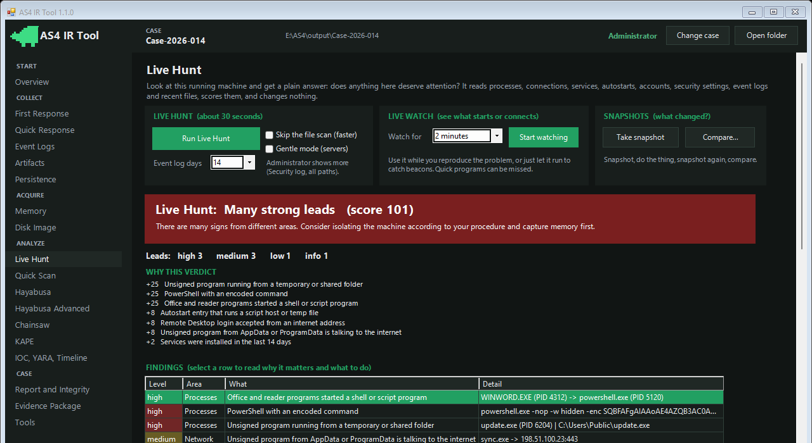
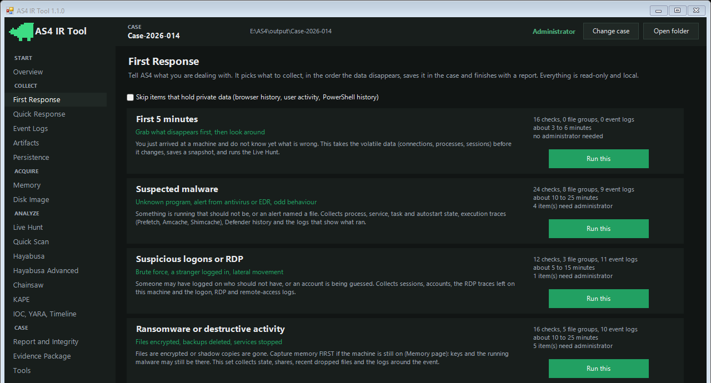
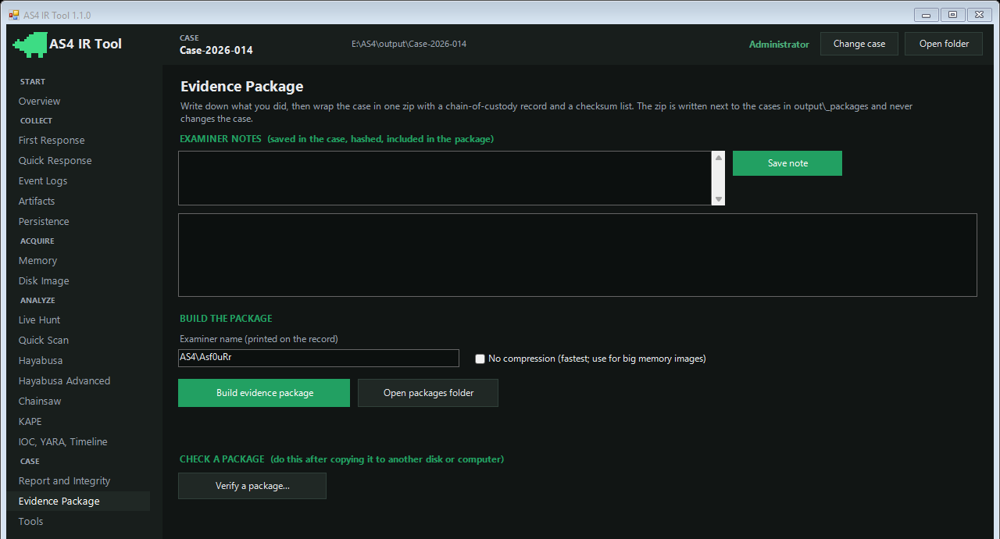

<p align="center"></p>

<h1 align="center">AS4 IR Tool</h1>
<p align="center"><i>flying without wings</i></p>

<p align="center">
A Windows incident-response toolkit that lives in one folder.<br>
Plug it in, run it, read the answer, take the evidence home.
</p>

---

## Why this exists

When a machine is acting strange you usually have about ten minutes before someone reboots it, and you do not get to install anything on it. So I wanted one folder I could carry on a USB stick that:

- grabs the things that vanish first,
- looks at the live machine and tells me in plain words if something smells wrong,
- writes everything down so I can prove later what I did.

No installer. No cloud. No "phone home". It only looks.

## See it

<p align="center"></p>
<p align="center"><sub>Live Hunt on sample data: a verdict in plain words, why, and every lead with what to do next.</sub></p>

<p align="center"> </p>
<p align="center"><sub>First Response (pick the situation) and the evidence package. Screenshots use made-up names and sample findings.</sub></p>

## A minute with it

Open `AS4_IR_Tool.exe`, type a case name, click **First Response**, pick what you're dealing with:

> First 5 minutes · Suspected malware · Suspicious logons or RDP · Ransomware · Data theft · Persistence sweep · Everything

AS4 collects in the order the data dies (connections and processes before files, files before logs), runs the **Live Hunt**, and hands you a report. The report starts with a verdict in normal language, then the leads, then *why each one matters* and *what to do next*, then the things it could not see.

That last part matters. A tool that only says "clean" is lying to you.

## What's in the box

**Live Hunt** · thirty seconds, read-only. It checks things like a `svchost.exe` living in the wrong folder, Word starting PowerShell, encoded commands, an LSASS dump, unsigned programs running out of Temp, odd connections, about twenty places malware hides to survive a reboot, new admins, Defender switched off, and a few dozen more. Every rule is a line in `config/profiles/live_indicators.json`, so you can add your own.

**Live Watch** · sits quietly and writes down what starts, connects and resolves. If something phones home on a steady rhythm, it says so.

**Snapshots** · take one, do the thing, take another, compare. Or compare against a clean reference machine.

**Evidence package** · a zip with a chain-of-custody sheet, a checksum for every file, and a verify button that notices if anyone touched it.

**Plus the classics** · live-response commands, Prefetch / Amcache / Shimcache / jump lists / browser history / SRUM, event-log export, memory and disk imaging (WinPmem, FTK Imager), KAPE, Hayabusa with 21 ready-made questions, Chainsaw, YARA, IOC search, a UTC timeline, and Quick Scan: point it at any folder of logs and get a verdict.

## Running it

| | |
|---|---|
| `AS4_IR_Tool.exe` | the window |
| `AS4_IR_Tool_Admin.exe` | same, as administrator (sees much more) |
| `AS4_IR_Tool_CLI.exe` | menus in a console; `-Check` tests the folder; `-Batch hunt -Case "Name"` runs unattended |
| `scripts\Start-Without-Exe.cmd` | if your policy blocks unsigned exe files |

The exe files are tiny launchers and are not code-signed. Sign them yourself with `scripts\Build-Exe.ps1 -SignThumbprint <cert>` if you need to.

## On a machine you don't trust

- Run it from a USB stick and keep `output\` there. AS4 writes only inside its own folder.
- Everything it needs is in the folder, including the Visual C++ runtime DLLs. It downloads nothing and installs nothing. While I tested a full First Response and a package build I watched Temp, AppData, ProgramData and Windows\Temp: nothing was created or changed.
- It runs at low priority. On a server, or when the CPU is busy, it switches to a gentler mode on its own (pauses, no file scan, fewer signature checks).
- Windows will still log that programs ran (Prefetch, event logs). I can't stop that, and neither can you.
- Only one optional thing writes to the registry: Autoruns, which wants to record that you accepted its licence. It's off by default and the console warns you first.

## Where things go

```
AS4\
  app\        the engine and the two interfaces
  tasks\      one file per job (Live Hunt, Scenarios, Package, Hayabusa, ...)
  config\     rules and presets, all plain JSON
  tools\      third-party programs, every one optional (see tools\README.md)
  output\     one folder per case, plus _packages\
  scripts\    fetch tools, run the self-test, build the exes and the release
  docs\
```

Each case folder is numbered so you can find things half asleep: `01_System_Info`, `02_Network`, ... `12_Reports`, `13_Collection_Logs`, `14_Live_Analysis`.

## Things I won't pretend

- Running any program changes a live machine. Memory capture is never free.
- A live view can't see code that exists only in memory or hides from Windows itself. If you suspect that, capture memory.
- Without administrator it can't read the Security log, Prefetch, or other users' process paths. The report tells you when that happened.
- Rule hits are leads, not verdicts. You decide.
- Tested on Windows 10 and 11 (64-bit). Older Windows, 32-bit and ARM: untested.

## Build and test

```powershell
powershell -NoProfile -ExecutionPolicy Bypass -File scripts\Test-AS4.ps1    # self-test, synthetic data only
powershell -NoProfile -ExecutionPolicy Bypass -File scripts\Build-Exe.ps1   # the launcher exes
powershell -NoProfile -ExecutionPolicy Bypass -File scripts\New-Release.ps1  # dist\AS4_IR_Tool_<version>.zip
```

The release zip carries only what the licences allow (Hayabusa, Chainsaw, YARA, WinPmem, the Microsoft runtime DLLs). KAPE, FTK Imager and the Sysinternals tools are yours to add: `tools\README.md` says how.

More in `docs\`: [Quick start](docs/QUICK_START.md) · [Live analysis](docs/LIVE_ANALYSIS.md) · [Evidence handling](docs/EVIDENCE_HANDLING.md) · [Troubleshooting](docs/TROUBLESHOOTING.md) · [Licences](docs/LICENSES.md)

## Licence

MIT for the AS4 code (`LICENSE`). Bundled programs keep their own licences.

Only use it on systems you're allowed to examine.
